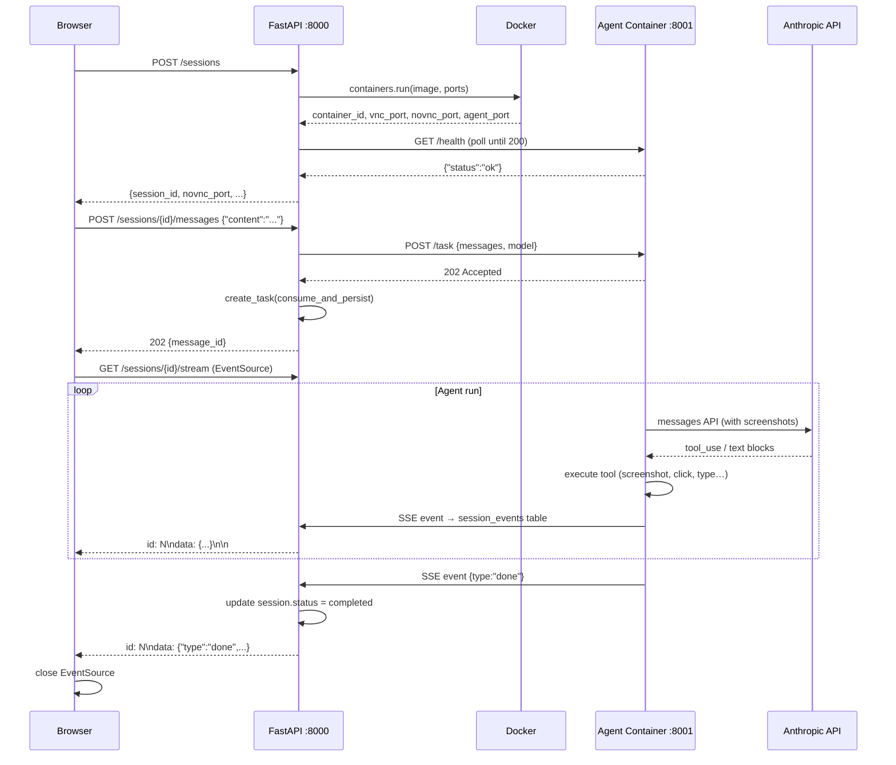

Author: Abdelrahman Rashad

# Computer Use Agent API

A production-grade FastAPI backend that replaces the Streamlit interface in Anthropic's [`computer-use-demo`](https://github.com/anthropics/anthropic-quickstarts/tree/main/computer-use-demo) with a concurrent, streaming, multi-session API.

## Demo

[Watch the demo on Google Drive](https://drive.google.com/file/d/1iNmg1KYfIoUnpPe549EhixIBlg-MQU65/view?usp=sharing)

## Features

- **Dynamic concurrency** — one isolated Docker container per session; no fixed pool size
- **Real-time streaming** — SSE event feed (text, tool calls, screenshots) stored in Postgres and replayed on reconnect via `Last-Event-ID`
- **VNC per session** — each container runs its own Xvfb + x11vnc + noVNC stack; ports are dynamically allocated
- **Multi-turn sessions** — send follow-up tasks to the same session without spawning a new container
- **TTL reaper** — idle containers are automatically stopped after 1 hour
- **Vanilla frontend** — 3-panel UI (session list / VNC iframe / chat log); pin up to 2 sessions side-by-side for concurrent demos

## Architecture

```
┌─────────────────────────────────────────────────────────┐
│  FastAPI Server  :8000                                  │
│  ├── PostgreSQL  (session + message + event history)    │
│  ├── Docker SDK  (spawns/stops agent containers)        │
│  └── SSE router  (polls session_events table)           │
└──────────────────────┬──────────────────────────────────┘
                       │ /var/run/docker.sock
          ┌────────────▼────────────┐  ┌─────────────────────┐
          │  Agent Container A      │  │  Agent Container B  │
          │  Xvfb  :99             │  │  Xvfb  :99         │
          │  x11vnc → host:VVVV    │  │  x11vnc → host:WWWW │
          │  noVNC  → host:NNNN    │  │  noVNC  → host:MMMM │
          │  agent shim → host:PPPP│  │  agent shim → :QQQQ │
          └─────────────────────────┘  └─────────────────────┘
```

Ports are allocated dynamically with `socket.bind(('', 0))` — no hard-coded concurrency limit.

## Quick Start

### Prerequisites

- Docker (tested on 27.x)
- An [Anthropic API key](https://console.anthropic.com/)

### 1. Build the agent image

```bash
docker build -t computer-use-agent:local -f Dockerfile.agent .
```

This extends `ghcr.io/anthropics/anthropic-quickstarts:computer-use-demo-latest` and adds the FastAPI shim.

### 2. Configure environment

```bash
cp .env.example .env
# edit .env and set ANTHROPIC_API_KEY=sk-ant-...
```

### 3. Start the stack

```bash
docker compose up --build -d
```

The API server and Postgres start immediately. Agent containers are spawned on demand when you create a session.

### 4. Open the UI

Navigate to **http://localhost:8000** in your browser.

Click **+ New Session**, wait ~10–20 s for the container to start, then type a task such as:

> Search the weather in Dubai

## API Reference

All endpoints are also documented at **http://localhost:8000/docs**.

### Sessions

| Method | Path | Description |
|--------|------|-------------|
| `POST` | `/sessions` | Create a session and spawn an agent container |
| `GET` | `/sessions` | List all sessions |
| `GET` | `/sessions/{id}` | Session detail with full message history |
| `DELETE` | `/sessions/{id}` | Stop container and hard-delete session |

**POST /sessions** — request body (all optional):
```json
{ "model": "claude-sonnet-4-5-20250929" }
```

**POST /sessions** — response:
```json
{
  "id": "550e8400-...",
  "status": "running",
  "model": "claude-sonnet-4-5-20250929",
  "vnc_port": 54321,
  "novnc_port": 54322,
  "created_at": "2025-01-01T00:00:00Z",
  "updated_at": "2025-01-01T00:00:00Z"
}
```

### Messages

| Method | Path | Description |
|--------|------|-------------|
| `POST` | `/sessions/{id}/messages` | Send a task; starts the agent run |
| `GET` | `/sessions/{id}/messages` | Retrieve full message history |

**POST /sessions/{id}/messages** — request body:
```json
{ "content": "Search the weather in Dubai" }
```

### SSE Stream

```
GET /sessions/{id}/stream
```

Returns a `text/event-stream`. Supports `Last-Event-ID` for reconnect replay.

Each event is JSON with a `type` field:

| Type | Fields | Description |
|------|--------|-------------|
| `text` | `content` | Assistant text output |
| `tool_use` | `name`, `id`, `input` | Tool call (e.g. `computer`) |
| `tool_result` | `content`, `is_image`, `base64` | Tool output or screenshot |
| `thinking` | `content` | Extended thinking block |
| `done` | `content` | Task complete |
| `error` | `content` | Error message |

Example:
```
id: 1
data: {"type":"tool_use","name":"computer","id":"tu_01","input":{"action":"screenshot"}}

id: 2
data: {"type":"tool_result","is_image":true,"base64":"iVBORw0KGgo..."}

id: 3
data: {"type":"done","content":"Task complete."}
```

## Sequence Diagram



## Project Structure

```
├── Dockerfile.api          # FastAPI server image (python:3.11-slim)
├── Dockerfile.agent        # Agent container (extends computer-use-demo)
├── docker-compose.yml      # API + PostgreSQL; agent containers spawned at runtime
├── .env.example            # Environment variable template
│
├── api/
│   ├── main.py             # FastAPI app, CORS, lifespan, serves frontend
│   ├── database.py         # Async SQLAlchemy engine + session factory
│   ├── models.py           # Session, Message, Screenshot, SessionEvent ORM models
│   ├── schemas.py          # Pydantic request/response shapes
│   ├── session_manager.py  # Docker SDK: spawn/stop, consume_and_persist, TTL reaper
│   ├── requirements.txt
│   └── routers/
│       ├── sessions.py     # POST/GET/DELETE /sessions
│       ├── messages.py     # POST/GET /sessions/{id}/messages
│       └── stream.py       # GET /sessions/{id}/stream (SSE)
│
├── agent/
│   ├── agent_server.py     # FastAPI shim: POST /task, GET /stream, GET /health
│   └── agent_entrypoint.sh # Starts Xvfb, x11vnc, noVNC, uvicorn
│
└── frontend/
    └── index.html          # Vanilla JS/CSS — session list, VNC iframe, SSE chat
```

## Design Decisions

| Decision | Choice | Reason |
|----------|--------|--------|
| Concurrency model | One Docker container per session | Display isolation (separate Xvfb) and truly dynamic spawn |
| Streaming protocol | SSE | Unidirectional server→client; simpler than WebSocket |
| Database | PostgreSQL + asyncpg | Binary screenshot storage; better concurrency than SQLite |
| SSE consumer | API eagerly consumes agent stream; browser reads DB | Prevents event loss on browser disconnect; enables `Last-Event-ID` replay |
| Port allocation | `socket.bind(('', 0))` | OS-level atomicity; no hard-coded concurrency limit |
| Default model | `claude-sonnet-4-5-20250929` | Cost — Sonnet is ~5× cheaper than Opus |
